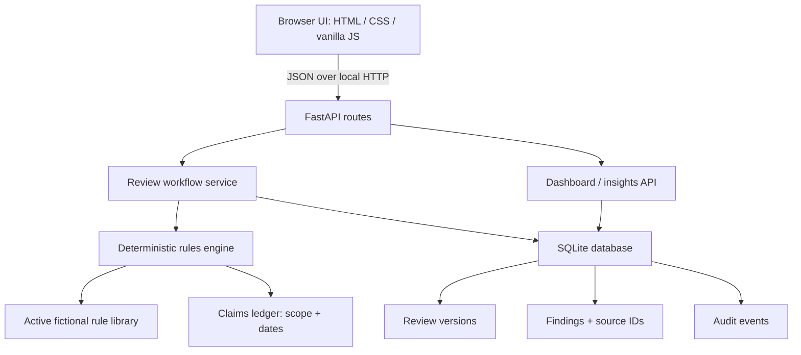

# BrandLens MVP Architecture

## Runtime flow

## Persistence model

- `rules`: rule ID, title, category, severity, rule text, source name, version and active state.
- `claims`: exact claim text, product scope, channel scope, evidence reference, approver, validity period and status.
- `reviews`: title, channel, product scope, workflow status and current version.
- `review_versions`: immutable text versions linked to a review.
- `findings`: version-scoped issue, severity, explanation, suggested step, source ID/label, state and dispute reason.
- `audit_events`: actor label, demo role, event type, version and detail.

SQLite is used so the prototype runs on a student's Windows laptop without PostgreSQL service setup. The database is local and created at first launch. It is not encrypted and is not a multi-tenant datastore.

## Rule-processing sequence

1. Match exact seed claim text against the claim ledger, ignoring punctuation-only differences.
2. Evaluate validity dates and the selected product/channel scope for a matching claim.
3. Identify unsupported comparative/superlative and quantified language using explicit patterns. These are flags requiring evidence, not assertions that a claim is false.
4. Flag guarantee and rapid-result wording against a rule ID.
5. Apply an advisory tone heuristic for all-caps words/repeated exclamation marks, and a terminology preference check.
6. Save each finding with a rule ID or claim-record ID, a source label, a reason and a proposed next step.
7. Let the user accept, dispute or revise. “Accept suggestion” records acknowledgement only; it does not silently mutate the draft. Edits create a new version and rerun checks.
8. Require an authorised demo role for approval actions. If open/disputed findings remain, a reviewer must record an override rationale.

## API and technical decisions

FastAPI provides JSON endpoints and serves the front-end assets. Pydantic models validate payload shape/lengths. SQLite foreign keys link review versions and findings. The app uses no third-party runtime AI service; no API key is needed. The initial build intentionally favors a small inspectable workflow over unreliable breadth.

## Security boundary (important)

The role passed in an API action is a demonstration control, not an authenticated identity. A caller can set `actor_role` in a request, so it must not be treated as a real access-control boundary. There is no user login, organization-level isolation, encryption at rest, file upload or production secret store. Never use confidential drafts in the demo.

## Planned but not implemented

- React/Next.js frontend and Tailwind build pipeline.
- PostgreSQL + pgvector or other semantic retrieval.
- Claude or another LLM provider behind an adapter, including model/version and retention review.
- DOCX/PDF parsing, OCR, image/logo and accessibility asset checks.
- Real user authentication, secure role grants and organization-level data separation.
- External notifications, hosted deployment and security hardening.
